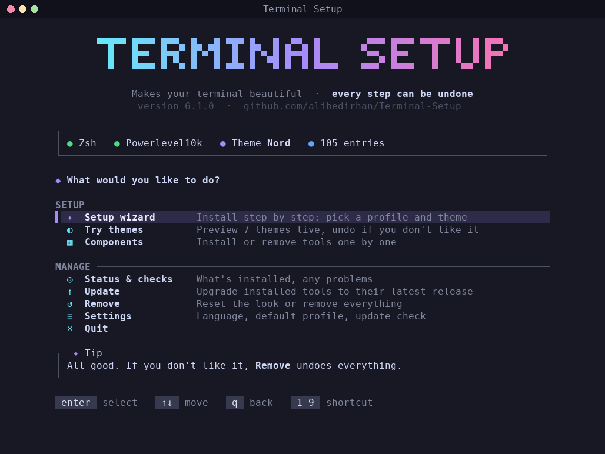
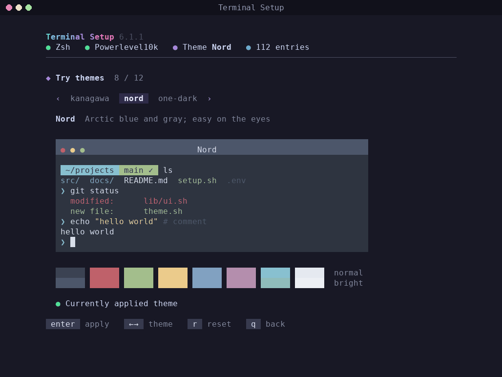

# Terminal Setup

A setup tool that makes the Ubuntu terminal beautiful and useful in one go — and **can undo everything it does**. It installs Zsh, Starship, 12 color themes, 14 modern command-line tools and tmux from a single menu; the theme you pick is applied to the prompt and the tools too (bat, delta, fzf, eza, tmux, lazygit, btop), not just the terminal. If you don't like the result, one command returns the system to its pre-install state; nothing you had before is touched.


> Türkçe: [README.md](README.md)

## Why it's different

Most setup scripts add things to your system but don't know how to take them back. Terminal Setup does three things:

1. **Baseline snapshot:** before the first install, the state of the system (packages, login shell, git and terminal settings) is recorded.
2. **Change ledger:** every installed package, every created file and every changed setting is written down as one line.
3. **Verified removal:** uninstall replays the ledger backwards, then compares the system with the snapshot and reports: `Result: no leftovers.`

A package you already had (e.g. tmux) or a file you already had (e.g. your own `.zshrc`) is never removed. Data created by use, such as your command history, is not deleted either; it is moved to an archive folder.

## What gets installed

| Group | Components |
|---|---|
| Shell | Zsh (made the default shell; history, completion and key settings without needing Oh My Zsh), Starship (a prompt that follows the theme and personality), a welcome card (only what needs attention, plus your last project: `resume`), optional Oh My Zsh and Powerlevel10k, the MesloLGS NF font, autosuggestion and syntax-highlighting plugins, fzf-tab (searchable Tab completion) |
| Tools | fzf, zoxide, eza, bat, ripgrep, fd, delta, lazygit, btop, dust, duf, procs, atuin, tldr (tealdeer) |
| Extras | tmux (themed status bar), handy aliases, your existing `~/.bash_aliases` loaded in zsh, optional JetBrains Mono and Fira Code Nerd Fonts |
| Themes | Dark: Catppuccin Mocha, Dracula, Everforest, Gruvbox, Kanagawa, Nord, One Dark, Rosé Pine, Solarized, Tokyo Night. Light: Catppuccin Latte, Gruvbox Light |
| Terminals | GNOME Terminal, Ptyxis (Ubuntu 25.10+), Kitty, Alacritty, Ghostty, WezTerm |
| Tools follow the theme | Colors: bat and delta (syntax theme), fzf, eza, tmux, lazygit, btop, the welcome card. Shape comes from the theme's personality: fzf and lazygit borders, the tmux status bar, eza icons and date format, the bat frame, the card's border and marks |

Three ready-made profiles: **minimal** (shell), **developer** (shell + developer tools, the default) and **full** (everything).

On Ptyxis, Catppuccin and Gruvbox are written together with their light/dark twin: when the system switches to the light style, the terminal follows automatically.

**Shortcuts:** the "Shortcuts" screen in the menu (or `./terminal-setup.sh tips`) shows how to use what was installed: Ctrl+R, Ctrl+T, `z project`, `lg`... Turn on "Startup tip" in Settings to get one reminder in every new terminal.

## Quick start

```bash
git clone https://github.com/alibedirhan/Terminal-Setup.git
cd Terminal-Setup
./terminal-setup.sh
```

The menu is driven with the arrow keys:



In "Try themes" every theme is previewed in a terminal window drawn with its own colors:



To run a verified release without cloning (checked with SHA-256), see the [installation guide](docs/INSTALL.md).

## Language

The interface is available in Turkish and English. It opens in Turkish when your system language is Turkish and in English otherwise. Change it permanently in **Settings → Dil / Language**, or for a single run with `--lang en` / `--lang tr`.

## Command line

Everything the menu does also works non-interactively:

```bash
./terminal-setup.sh install --profile full --theme nord   # install
./terminal-setup.sh theme preview dracula                  # preview a theme in the terminal
./terminal-setup.sh theme apply dracula                    # apply a theme
./terminal-setup.sh style set retro                        # choose a personality (auto: the theme's)
./terminal-setup.sh theme reset                            # restore the original colors
./terminal-setup.sh remove lazygit                         # remove one component
./terminal-setup.sh update                                 # upgrade installed tools
./terminal-setup.sh status                                 # what is installed
./terminal-setup.sh doctor                                 # health check (including zsh startup time)
./terminal-setup.sh tips                                   # shortcuts of the installed tools
./terminal-setup.sh font set jetbrains                     # change the font
./terminal-setup.sh --dry-run uninstall                    # see what removal would do
./terminal-setup.sh uninstall                              # undo everything
```

`--dry-run` works with every command: it changes nothing and only shows the plan.

## Removal

There are two levels:

- **Reset the look:** the theme and terminal colors go back; the tools stay.
- **Remove everything:** the plan is shown first and you type `remove` to confirm. Then the packages the tool installed are removed (a package another package still needs is skipped), downloaded tools, plugins and fonts are deleted, files such as `.zshrc`, `.gitconfig` and `.tmux.conf` return to their pre-install state, the login shell and terminal profile are restored, and the system is compared with the baseline snapshot.

Only an archive folder, `~/terminal-setup-removed-DATE/`, is left behind (`~/terminal-setup-kaldirilan-TARİH/` on a Turkish system). It contains the removal report, the log, your command history, the settings you saved in the tools (lazygit, btop, atuin) and the latest version of files you edited after installing. Delete it whenever you like.

## Requirements

- Ubuntu 22.04, 24.04 or 26.04 (x86_64 or ARM64)
- Bash 4.4+
- `sudo` rights and an internet connection

## Quality

- CI on every push: ShellCheck (zero warnings), a 600-line file limit, and the rule that only `lib/actions/` may change the system.
- 234 unit, integration and interaction tests on a fake system (they never touch the real system or the network).
- Real round-trip tests in clean Ubuntu 22.04, 24.04 and 26.04 containers: full install → zsh session → uninstall → are packages, home directory, shell and `/etc/shells` identical to before?
- Real GNOME Terminal and Ptyxis tests with dconf on the same three releases.
- An English interface test: the whole flow runs in English; a single untranslated or leftover Turkish string fails it.

Architecture and how to add components, themes or terminals: [docs/ARCHITECTURE.md](docs/ARCHITECTURE.md) (Turkish).

Recent development and current status: [project summary](docs/PROJE_OZETI.md) (Turkish).

## Contributing and support

- [Contributing](.github/CONTRIBUTING.md) — development and tests (Turkish)
- [Support](.github/SUPPORT.md) — reporting problems (Turkish)
- [Security](.github/SECURITY.md) — security principles and reporting vulnerabilities (Turkish)
- [Changelog](CHANGELOG.md) — release notes

## License

MIT — see [LICENSE](LICENSE).
