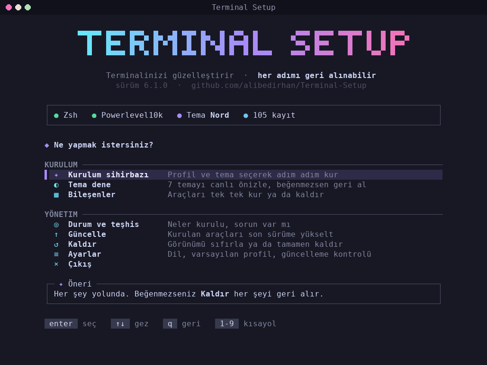
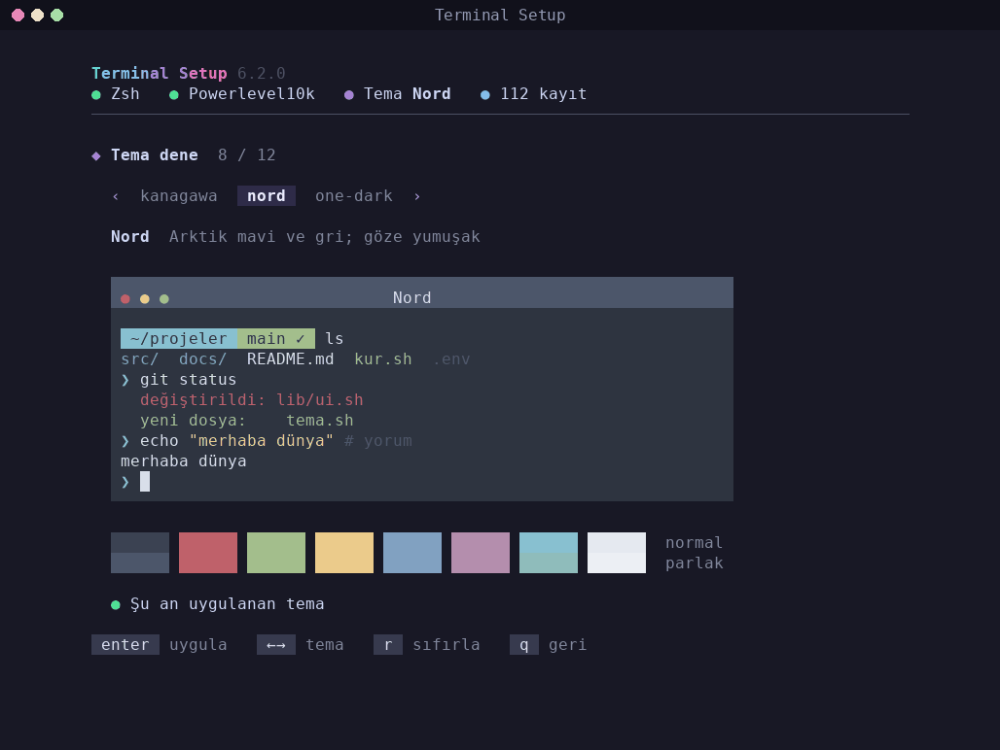

# Terminal Setup

Ubuntu terminalini tek seferde güzel ve kullanışlı hale getiren, **yaptığı her şeyi geri alabilen** kurulum aracı. Zsh, Oh My Zsh, Powerlevel10k (ya da Starship), 12 renk teması, 14 modern komut satırı aracı ve tmux'u bir menüden kurar; seçtiğiniz tema terminalle birlikte bat, delta, fzf ve btop'a da uygulanır. Beğenmezseniz tek komutla kurulumdan önceki haline döner; kurulumdan önce sizde olan hiçbir şeye dokunmaz.


> **English:** the interface is also available in English — see [README.en.md](README.en.md).

## Neden farklı?

Çoğu kurulum betiği sisteme bir şeyler ekler ama nasıl geri alınacağını bilmez. Terminal Setup üç şey yapar:

1. **Başlangıç fotoğrafı:** İlk kurulumdan önce sistemin hali (paketler, kabuk, git ve terminal ayarları) kaydedilir.
2. **Değişiklik defteri:** Kurulan her paket, oluşturulan her dosya, değiştirilen her ayar bir satır olarak yazılır.
3. **Kanıtlı kaldırma:** Kaldırma defteri sondan başa geri alır, sonra sistemi fotoğrafla karşılaştırıp rapor verir: `Sonuç: kalıntı yok.`

Kurulumdan önce sizde olan bir paket (ör. tmux) ya da dosya (ör. kendi `.zshrc`'niz) kaldırmada silinmez. Komut geçmişiniz gibi kullanımla oluşan veriler silinmez; arşiv klasörüne taşınır.

## Neler kurulur?

| Grup | Bileşenler |
|---|---|
| Kabuk | Zsh (varsayılan kabuk yapılır), Oh My Zsh, Powerlevel10k ya da Starship, MesloLGS NF yazı tipi, komut önerisi ve sözdizimi renklendirme eklentileri, fzf-tab (Tab ile aranabilir tamamlama) |
| Araçlar | fzf, zoxide, eza, bat, ripgrep, fd, delta, lazygit, btop, dust, duf, procs, atuin, tldr (tealdeer) |
| Ekstra | tmux (temalı durum çubuğu), örnek alias'lar ve mevcut `~/.bash_aliases` dosyanızın zsh'e bağlanması, isteğe bağlı JetBrains Mono ve Fira Code Nerd Font |
| Temalar | Koyu: Catppuccin Mocha, Dracula, Everforest, Gruvbox, Kanagawa, Nord, One Dark, Rosé Pine, Solarized, Tokyo Night. Açık: Catppuccin Latte, Gruvbox Light |
| Terminaller | GNOME Terminal, Ptyxis (Ubuntu 25.10+), Kitty, Alacritty, Ghostty, WezTerm |
| Araç renkleri | bat ve delta (söz dizimi teması), fzf, btop ve tmux da seçilen temaya uyar |

Üç hazır profil vardır: **minimal** (kabuk), **developer** (kabuk + geliştirici araçları, varsayılan) ve **full** (her şey).

Ptyxis'te Catppuccin ve Gruvbox açık/koyu eşleriyle birlikte yazılır: sistem açık temaya geçince terminal de kendiliğinden açık renklere döner.

**Kısayollar:** Menüdeki "Kısayollar" ekranı (ya da `./terminal-setup.sh tips`) kurulan araçların nasıl kullanılacağını gösterir: Ctrl+R, Ctrl+T, `z proje`, `lg`... İsterseniz Ayarlar'dan "Açılış ipucu"nu açın; her yeni terminalde bir kısayol hatırlatılır.

## Hızlı başlangıç

```bash
git clone https://github.com/alibedirhan/Terminal-Setup.git
cd Terminal-Setup
./terminal-setup.sh
```

Menü ok tuşlarıyla gezilir:



"Tema dene" ekranında her tema, kendi renkleriyle çizilmiş bir terminal penceresinde önizlenir:



Arayüz hiçbir ek programa ihtiyaç duymaz. 24 bit, 256 ve 8 renkli terminallerde çalışır, `NO_COLOR` tanımlıysa renk kullanmaz; küçük pencerelerde sade başlığa geçer, uzun listeler kayar.

Depoyu klonlamadan, sürümü SHA-256 ile doğrulayarak çalıştırmak için [INSTALL.md](INSTALL.md)'ye bakın.

## Komut satırından

Menünün yaptığı her şey etkileşimsiz de yapılabilir:

```bash
./terminal-setup.sh install --profile full --theme nord   # kur
./terminal-setup.sh theme preview dracula                  # temayı terminalde önizle
./terminal-setup.sh theme apply dracula                    # temayı uygula
./terminal-setup.sh theme reset                            # renkleri eski haline döndür
./terminal-setup.sh remove lazygit                         # tek bileşeni kaldır
./terminal-setup.sh update                                 # kurulan araçları son sürüme güncelle
./terminal-setup.sh status                                 # neler kurulu
./terminal-setup.sh doctor                                 # sağlık kontrolü (zsh açılış süresi dahil)
./terminal-setup.sh tips                                   # kurulan araçların kısayolları
./terminal-setup.sh font set jetbrains                     # yazı tipini değiştir
./terminal-setup.sh --dry-run uninstall                    # kaldırınca ne olacağını gör
./terminal-setup.sh uninstall                              # her şeyi geri al
```

`--dry-run` her komutla çalışır: hiçbir şeyi değiştirmez, yalnızca planı gösterir.

## Dil

Arayüz Türkçe ve İngilizcedir. Sistem diliniz Türkçeyse Türkçe, değilse İngilizce açılır. Menüde **Ayarlar → Dil / Language** ile kalıcı olarak, komut satırında `--lang en` ya da `--lang tr` ile tek seferlik değiştirilebilir.

## Tema denemek

"Tema dene" ekranında sol/sağ ok tuşlarıyla temalar arasında gezilir; 16 renk ve örnek bir prompt canlı önizlenir. Enter temayı uygular, `r` renkleri kurulum öncesine döndürür. Tema değiştirmek için araçları kaldırıp yeniden kurmak gerekmez.

## Kaldırma

İki seviye vardır:

- **Görünümü sıfırla:** Tema ve terminal renkleri eski haline döner; araçlar kalır.
- **Tamamen kaldır:** Önce plan gösterilir, onay için `kaldır` yazmanız istenir. Sonra:
  - script'in kurduğu paketler kaldırılır (bağımlılıkları dahil; başka bir paketin ihtiyaç duyduğu paket atlanır),
  - indirilen araçlar, eklentiler ve yazı tipleri silinir,
  - `.zshrc`, `.gitconfig`, `.tmux.conf` gibi dosyalar kurulum öncesi haline döner,
  - giriş kabuğu ve terminal profili geri yüklenir,
  - sistem başlangıç fotoğrafıyla karşılaştırılır.

Geriye yalnızca `~/terminal-setup-kaldirilan-TARİH/` arşiv klasörü kalır. İçinde kaldırma raporu, log, komut geçmişiniz ve kurulumdan sonra elle değiştirdiğiniz dosyaların son hali bulunur. İstediğiniz zaman silebilirsiniz.

v5 ve öncesiyle kurulum yaptıysanız (defter yoksa) "Kaldır" menüsü eski kurulumu algılar ve her adımı ayrıca sorarak temizler.

## Dosyalar nerede?

| Konum | İçerik |
|---|---|
| `~/.terminal-setup/` | defter, başlangıç fotoğrafı, log, ayarlar |
| `~/.config/terminal-setup/` | zsh ve tmux ayar parçaları |
| `~/.local/bin/` | GitHub'dan indirilen araçlar (fzf, zoxide, eza, delta, lazygit, dust, procs, atuin) |
| `~/.zshrc` | yalnızca tek bir işaretli blok eklenir; kendi satırlarınıza dokunulmaz |

Kendi zsh ayarlarınızı `~/.zshrc` içinde, `terminal-setup` bloğunun dışına yazın.

## Gereksinimler

- Ubuntu 22.04, 24.04 veya 26.04 (x86_64 ya da ARM64)
- Bash 4.4+
- `sudo` yetkisi ve internet bağlantısı

## Proje yapısı

```text
terminal-setup.sh   giriş noktası
lib/                motor: defter, fotoğraf, eylemler, geri alma, çalıştırıcı, dil
locale/             İngilizce çeviriler (en.sh)
components/         25 bileşen, her biri 10-40 satırlık tek dosya
themes/             12 renk paleti (yalnızca veri)
renderers/          paleti terminallere ve araçlara çeviren 9 renderer
frontends/          menü (tui/) ve komut satırı (cli.sh)
diagnostics/        8 sağlık kontrolü
profiles/           minimal, developer, full
tests/              birim, entegrasyon ve Docker gidiş-dönüş testleri
```

Mimari, kurallar ve yeni bileşen/tema/terminal ekleme: [docs/ARCHITECTURE.md](docs/ARCHITECTURE.md).

## Kalite

- Her push'ta CI: ShellCheck (sıfır uyarı), 600 satır sınırı, "sisteme yalnızca `lib/actions/` dokunur" kuralı.
- 170 birim, entegrasyon ve etkileşim testi, sahte bir sistem üzerinde (gerçek sisteme dokunmaz, ağa çıkmaz).
- Temiz Ubuntu 22.04, 24.04 ve 26.04 konteynerlerinde gerçek gidiş-dönüş testi: tam kurulum → zsh oturumu → kaldırma → paket listesi, ev dizini, kabuk ve `/etc/shells` kurulum öncesiyle aynı mı?
- İngilizce arayüz testi: tüm akış İngilizce çalıştırılır; çevirisi eksik ya da Türkçe kalan tek bir metin testi düşürür.
- Aynı üç sürümde gerçek dconf ile GNOME Terminal ve Ptyxis testi: tema ve yazı tipi anahtarları şemaya uyuyor mu, kullanıcının kendi ayarları korunuyor mu, kaldırınca dconf eskisiyle aynı mı?

## Katkı ve destek

- [CONTRIBUTING.md](CONTRIBUTING.md) — geliştirme ve test
- [SUPPORT.md](SUPPORT.md) — sorun bildirme
- [SECURITY.md](SECURITY.md) — güvenlik
- [CHANGELOG.md](CHANGELOG.md) — sürüm notları

## Lisans

MIT — [LICENSE](LICENSE)

## Teşekkürler

[Oh My Zsh](https://ohmyz.sh/), [Powerlevel10k](https://github.com/romkatv/powerlevel10k) ve kurulan tüm araçların geliştiricilerine.
